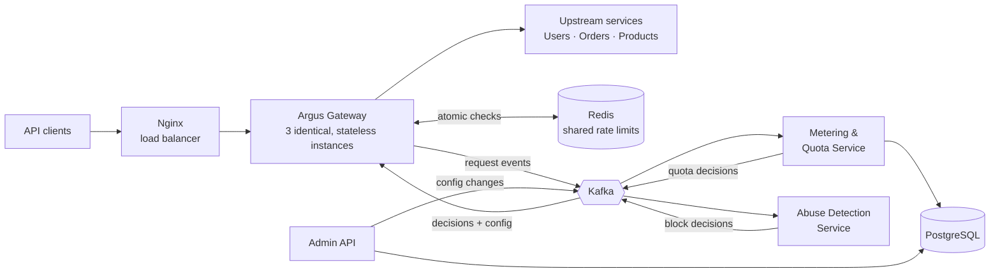

<div align="center">

# Argus

**A distributed API gateway with load balancing, rate limiting, and cross-instance traffic intelligence**

[](https://github.com/abdulmoeedsiddiqi/Argus/actions/workflows/ci.yml)


</div>

---

## Table of contents

- [Overview](#overview)
- [The problem](#the-problem)
- [Key features](#key-features)
- [Architecture](#architecture)
- [Design highlights](#design-highlights)
- [Technology stack](#technology-stack)
- [Repository structure](#repository-structure)
- [Getting started](#getting-started)
- [Configuration](#configuration)
- [Testing and quality](#testing-and-quality)
- [Project status and roadmap](#project-status-and-roadmap)
- [Documentation](#documentation)
- [Development workflow](#development-workflow)
- [AI usage disclosure](#ai-usage-disclosure)
- [Author](#author)

---

## Overview

Argus is an **API gateway**: the single entry point through which client applications reach a set of backend microservices. It authenticates every request once, routes it to the correct service, balances load across that service's replicas, enforces per-client rate limits, and protects the system when a backend fails.

Because a single gateway is both a bottleneck and a single point of failure, Argus runs as **multiple identical, stateless instances** behind a load balancer. Its distinguishing feature is **cross-instance traffic intelligence**: every instance streams request events to Kafka, so independent services can meter usage across the whole cluster, detect abuse that no single instance can see, and push enforcement decisions and configuration back to every instance.

> Developed as the joint semester project for **SE423 – Software Construction and Development** and **SE431 – Software Quality Assurance** at the Ghulam Ishaq Khan Institute (GIKI).

---

## The problem

Replicating a gateway solves capacity and availability, but creates a new problem: **each instance sees only part of the traffic.**

| Without cross-instance coordination | What goes wrong |
|---|---|
| Rate limits counted per instance | A client spreading requests over 3 instances gets 3× its limit |
| Usage counted in memory | Counts are wrong cluster-wide and lost when an instance crashes |
| Attacks seen per instance | 60 failed logins spread over 3 instances look like a normal 20 each |
| Fire-and-forget config updates | An instance that was restarting keeps accepting a revoked API key |

Argus keeps all important state **outside** the instances: shared counters in Redis, and events, decisions and configuration in Kafka.

---

## Key features

### Data plane (every gateway instance)

| Capability | Description |
|---|---|
| **Routing** | Path- and method-based route matching with immutable, versioned route snapshots |
| **Load balancing** | Pluggable strategies: round-robin, weighted, least-connections; weighted **canary** releases |
| **Health checking** | Active checks remove failed upstream instances and reintegrate recovered ones |
| **Authentication** | JWT validation and API keys stored only as SHA-256 hashes |
| **Distributed rate limiting** | Token bucket enforced **atomically across all instances** via a Redis Lua script, with local fallback |
| **Resilience** | Circuit breaker (closed / open / half-open), timeouts, and retries **only for idempotent requests** |

### Control plane (cross-instance intelligence)

| Capability | Description |
|---|---|
| **Usage metering and quotas** | Every request counted exactly once in a durable, replayable ledger; monthly plan quotas enforced |
| **Abuse detection** | Rules over the combined traffic of all instances; offending keys blocked everywhere |
| **Consistent configuration** | Route and key changes delivered through a compacted topic, so restarting instances rebuild current state |
| **Graceful degradation** | If Kafka is down, events spill to disk and replay later; if Redis is down, limits fall back locally |

### Observability

Prometheus metrics, Grafana dashboards, structured JSON logs with correlation IDs, and Kafka UI for inspecting topics.

---

## Architecture



### Kafka topics

| Topic | Type | Key | Producers → consumers |
|---|---|---|---|
| `gateway.request-events` | 7-day retention | API key ID | Gateways → Metering, Abuse Detection |
| `gateway.enforcement` | Log-compacted | API key ID | Metering, Abuse Detection → Gateways |
| `gateway.config` | Log-compacted | `entityType:entityId` | Admin API → Gateways |
| `gateway.request-events.dlq` | Dead-letter | – | Events that repeatedly fail processing |

### Request lifecycle

Each request passes through an ordered filter pipeline. Any filter may reject it, and later filters never run.

```
Authentication → Enforcement → Rate limit → Routing / load balancing → Proxy (circuit breaker, retries)
     401             403           429              404 / 503                    503 / 504
```

A detailed component diagram, six class diagrams, a sequence diagram and a state diagram are in [`docs/diagrams`](docs/diagrams).

---

## Design highlights

### Framework-free core (ports and adapters)

All business logic lives in `argus-core`, which depends **only on the JDK**. The core declares the interfaces it needs (`RateLimiter`, `EventPublisher`, `ApiKeyStore`, `EnforcementView`, `UpstreamClient`), and `argus-gateway` provides adapters for Redis, Kafka, JWT and HTTP. ArchUnit tests fail the build if the core imports Spring, Kafka, Redis or JPA, or if its packages form a dependency cycle.

### Design patterns

| Pattern | Category | Where | Problem solved |
|---|---|---|---|
| Builder | Creational | `Route.Builder` | Immutable routes with many optional parts |
| Factory Method | Creational | `LoadBalancingStrategyFactory` | Create strategies from configuration without exposing concrete classes |
| Chain of Responsibility | Behavioural | `GatewayFilter`, `FilterChain` | Ordered pipeline where any step can stop the request |
| Strategy | Behavioural | `LoadBalancingStrategy`, `RetryPolicy`, `DetectionRule` | Interchangeable algorithms per route |
| State | Behavioural | `CircuitState` (Closed, Open, HalfOpen) | Breaker behaviour depends on its state; thread-safe transitions |
| Decorator | Structural | `FallbackRateLimiter`, `SpillingEventPublisher` | Graceful degradation without changing wrapped components |
| Adapter | Structural | `RedisRateLimiter`, `KafkaEventPublisher` | Fit infrastructure APIs to core ports |
| Observer | Behavioural | `ConfigurationListener` | Several components react to each config change |

### Concurrency and consistency

| Shared state | Technique |
|---|---|
| Route table | Immutable snapshot behind an `AtomicReference`, swapped atomically |
| Round-robin position | `AtomicInteger` |
| Circuit-breaker state | `AtomicReference` with compare-and-set transitions; `Semaphore` for half-open trials |
| Local token buckets | `ReentrantLock` per bucket (avoids virtual-thread pinning) |
| Cross-instance rate limits | Single atomic Redis Lua script |
| Usage ledger | At-least-once delivery with deduplication by `event_id` → effectively-once counting |

**Consistency boundary:** rate limits are exact and immediate; quotas and abuse blocks are eventually consistent (seconds), by design, to keep the database and analytics off the request path.

Architectural decisions and the alternatives rejected are recorded in [`docs/adr`](docs/adr).

---

## Technology stack

| Layer | Technologies |
|---|---|
| Language and runtime | Java 21 (virtual threads), Spring Boot 3.5, Maven |
| Data | PostgreSQL 16, Flyway migrations, Redis 7 |
| Messaging | Apache Kafka (KRaft mode), Spring for Apache Kafka |
| Security | JWT (Nimbus JOSE + JWT), SHA-256 hashed API keys |
| Testing | JUnit 5, Mockito, AssertJ, Testcontainers, ArchUnit, JaCoCo, PIT, k6 |
| Code quality | SonarCloud, Checkstyle, SpotBugs, PMD |
| DevOps | GitHub Actions, Docker, Docker Compose, Kubernetes (kind), Nginx |
| Observability | Micrometer, Prometheus, Grafana, SLF4J/Logback |

---

## Repository structure

```
Argus/
├── argus-contracts/         Shared event records: RequestEvent, EnforcementDecision, ConfigChange, Topics
├── argus-core/              Framework-free business logic and ports
│   └── dev/argus/core/
│       ├── model/           Immutable value types (requests, routes, policies)
│       ├── pipeline/        Filter chain (Chain of Responsibility)
│       ├── routing/         Route and upstream registries, upstream client port
│       ├── loadbalancing/   Load-balancing strategies and factory
│       ├── auth/            Authenticators and API key store port
│       ├── ratelimit/       Rate limiter contract and policies
│       ├── resilience/      Circuit breaker states and retry policy
│       ├── events/          Event publisher, enforcement and configuration ports
│       └── exception/       Typed exception hierarchy
├── argus-gateway/           Spring Boot data plane: HTTP proxy, Redis/Kafka/JWT adapters
├── argus-admin/             Admin API for routes, consumers, plans and keys (+ Flyway schema)
├── argus-metering/          Usage ledger and quota enforcement (Kafka consumer)
├── argus-abuse/             Cross-instance abuse detection (Kafka consumer)
├── upstreams/mock-service/  Demo upstream (Users / Orders / Products) with fault injection
├── deploy/                  Docker Compose, Nginx, Prometheus, seed document; Kubernetes manifests (M3)
├── scripts/                 seed.sh: loads the demo configuration through the Admin API
├── docs/
│   ├── adr/                 Architecture Decision Records
│   ├── diagrams/            UML sources and rendered diagrams
│   └── BRANCHING.md         Branching strategy and quality gates
└── .github/workflows/ci.yml Continuous integration
```

---

## Getting started

### Prerequisites

| Tool | Version | Notes |
|---|---|---|
| JDK | 21 | Eclipse Temurin recommended |
| Maven | 3.9+ | |
| Docker Desktop | Compose v2 | On Windows, cap WSL2 memory (see below) |
| Git | any recent | |

<details>
<summary><b>Windows: limit Docker's memory use</b></summary>

Create `%UserProfile%\.wslconfig` so the full stack fits comfortably on a 16 GB machine:

```ini
[wsl2]
memory=10GB
processors=6
```

Then run `wsl --shutdown` and restart Docker Desktop.
</details>

### Clone and build

```bash
git clone https://github.com/abdulmoeedsiddiqi/Argus.git
cd Argus
./mvnw -B verify     # compile, run tests and architecture rules, coverage report, style checks
```

The Maven Wrapper (`mvnw`, `mvnw.cmd` on Windows) downloads the pinned Maven version, so only
JDK 21 has to be installed.

### Run locally

**Demo**: three gateway instances behind Nginx, PostgreSQL, Kafka (KRaft), the Admin API and six
backend copies. No profile and no manual build are needed; the images compile the code themselves:

```bash
docker compose -f deploy/docker-compose.yml up --build -d

# One command loads the demo configuration through the Admin API (never into the database):
# plans, backend copies, routes, consumers and their API keys.
scripts/seed.sh

deploy/smoke-test.sh          # authentication and routing through Nginx (port 8080)
deploy/propagation-test.sh    # a change reaches all 3 gateways; a restarted gateway catches up
```

The gateways start with no routes and no keys. Everything they know arrives from the Admin API
through the compacted Kafka topic `gateway.config`; an instance answers `503 NOT_READY` until it
has replayed that topic.

```bash
# The seed script saves the issued demo keys here (the file is ignored by Git):
source deploy/seed/demo-keys.txt

# Every request needs a credential: an API key ...
curl -i -H "X-API-Key: $SHOP_APP_KEY" http://localhost:8080/orders/42    # 200
curl -i http://localhost:8080/orders/42                                  # 401, no key
curl -i -H "X-API-Key: $REVOKED_KEY" http://localhost:8080/orders/42     # 401, revoked

# ... or a signed JWT (the script mints a demo token; "expired" gives one that is too old)
curl -i -H "Authorization: Bearer $(deploy/demo-jwt.sh)" http://localhost:8080/orders/42          # 200
curl -i -H "Authorization: Bearer $(deploy/demo-jwt.sh expired)" http://localhost:8080/orders/42  # 401

# Fault injection on a backend copy: ok | slow | fail  (orders-a is on host port 8081)
curl -X POST "http://localhost:8081/fault?mode=fail"
# After three failed health checks (about 15 s) orders-a stops receiving requests.
```

**Admin API** (port 9000, [Swagger UI](http://localhost:9000/swagger-ui.html)). Sign in, then send
the token with every call:

```bash
TOKEN=$(curl -s -X POST http://localhost:9000/admin/login -H 'Content-Type: application/json' \
  -d '{"username":"admin","password":"demo-admin-password-not-for-real-use"}' \
  | sed -n 's/.*"token":"\([^"]*\)".*/\1/p')

# Create a route: all three gateways use it within moments
curl -X POST http://localhost:9000/admin/routes -H "Authorization: Bearer $TOKEN" \
  -H 'Content-Type: application/json' \
  -d '{"id":"health","pathPrefix":"/health","serviceId":"orders","timeoutMs":3000}'

# Issue a key (the full key is shown this one time only), then revoke it
curl -X POST http://localhost:9000/admin/consumers/shop-app/keys -H "Authorization: Bearer $TOKEN"
curl -X POST http://localhost:9000/admin/keys/<key id>/revoke    -H "Authorization: Bearer $TOKEN"

# Who changed what, and when
curl http://localhost:9000/admin/audit -H "Authorization: Bearer $TOKEN"
```

| Admin endpoint | Purpose |
|---|---|
| `POST /admin/login` | Sign in; returns the admin token (JWT, valid 1 hour) |
| `/admin/plans`, `/admin/consumers`, `/admin/routes`, `/admin/upstreams` | Create (`POST`), list and read (`GET`), update (`PUT /{id}`), delete (`DELETE /{id}`) |
| `POST /admin/consumers/{id}/keys` | Issue an API key; the full key is returned once, only its SHA-256 hash is stored |
| `POST /admin/keys/{id}/rotate`, `POST /admin/keys/{id}/revoke` | Replace or revoke a key |
| `GET /admin/audit` | Audit log: actor, action, entity, time |
| `POST /admin/import` | Apply a YAML document such as `deploy/seed/demo-config.yaml` |
| `POST /admin/config/republish` | Send the whole current configuration to the gateways again |

> **Demo credentials are not secrets.** The administrator password and the signing secrets in
> `deploy/docker-compose.yml` exist only so the demo starts with one command; each can be
> overridden with an environment variable. API keys are generated by the Admin API, shown once,
> and stored only as SHA-256 hashes. A real deployment supplies its own values.

A 200 answer carries `X-Argus-Upstream` (the backend copy that answered). A refusal is a JSON
body with a reason code, for example `{"reason":"AUTHENTICATION_FAILED",...}` or
`{"reason":"ROUTE_NOT_FOUND",...}`.

| Route | Backend copies | Load balancing |
|---|---|---|
| `/orders` | `orders-a` (weight 3), `orders-b` (weight 1) | Weighted 3:1 |
| `/users` | `users-a`, `users-b` | Least connections |
| `/products` | `products-v1`, `products-v2` | Round robin, 10% canary to `v2` |

These routes are defined in `deploy/seed/demo-config.yaml` and created by `scripts/seed.sh`.

| Profile | Starts | Use for |
|---|---|---|
| (none) | Nginx, 3 gateways, Admin API, PostgreSQL, Kafka, six backend copies | The demo above |
| `full` | + Redis, metering, abuse detection, Prometheus, Grafana, Kafka UI | Later modules and monitoring |

```bash
# Stop everything (the configuration is not kept: seed again after the next start)
docker compose -f deploy/docker-compose.yml --profile full down
```

### Service endpoints

| Service | URL |
|---|---|
| Gateway, through Nginx (what clients use) | http://localhost:8080 |
| One gateway instance directly: `gateway-1`, `gateway-2`, `gateway-3` | http://localhost:8091, :8092, :8093 |
| Admin API / Swagger UI | http://localhost:9000/swagger-ui.html |
| Backend copies `orders-a`, `orders-b`, `products-v2` (for `POST /fault`) | http://localhost:8081, :8082, :8083 |
| Grafana (`full` profile) | http://localhost:3000 |
| Prometheus (`full` profile) | http://localhost:9090 |
| Kafka UI (`full` profile) | http://localhost:8090 |

---

## Configuration

Services are configured through environment variables (set in `deploy/docker-compose.yml`):

| Variable | Used by | Purpose |
|---|---|---|
| `ARGUS_INSTANCE_ID` | Gateway | Identifies the instance in events and metrics |
| `SPRING_PROFILES_ACTIVE=demo` | Gateway | Demo settings that are not part of the Admin API configuration (JWT issuer) |
| `ARGUS_CONFIG_SOURCE` | Gateway | `kafka`: routes, backend copies and keys come from the Admin API through `gateway.config`. `static` (default): from the configuration file (`argus.routes`, `argus.upstreams`, `argus.auth.api-keys`) |
| `ARGUS_ADMIN_USERNAME` / `ARGUS_ADMIN_PASSWORD` | Admin | The administrator who may sign in at `POST /admin/login` |
| `ARGUS_ADMIN_JWT_SECRET` | Admin | HS256 secret for admin tokens (at least 32 bytes); the Admin API does not start without it |
| `ARGUS_AUTH_JWT_SECRET` | Gateway | Shared HS256 secret for JWT validation (at least 32 bytes). JWTs are refused when it is not set |
| `ARGUS_AUTH_JWT_ISSUER` | Gateway | Issuer a JWT must name (`argus-demo` in the demo profile) |
| `ARGUS_HEALTH_CHECK_*` | Gateway | Active health checks: `ENABLED`, `PATH` (`/health`), `INTERVAL` (5s), `TIMEOUT` (2s), `FAILURE_THRESHOLD` (3) |
| `SPRING_KAFKA_BOOTSTRAP_SERVERS` | Gateway, Admin, Metering, Abuse | Kafka address |
| `SPRING_DATA_REDIS_HOST` | Gateway | Redis address for shared rate limits |
| `SPRING_DATASOURCE_URL` / `_USERNAME` / `_PASSWORD` | Admin, Metering | PostgreSQL connection |
| `PORT` | All services | HTTP port (defaults: gateway 8080, admin 8081, metering 8082, abuse 8083, mock upstream 8081) |
| `SERVICE_NAME` | Mock upstream | Runs the mock as `users`, `orders` or `products` |

---

## Testing and quality

| Layer | Tools | What it verifies |
|---|---|---|
| Unit | JUnit 5, Mockito, AssertJ | Core logic, using a fake clock for time-based behaviour |
| Concurrency | JUnit 5, virtual threads | e.g. 50 concurrent requests against a limit of 10 allow exactly 10 |
| Architecture | ArchUnit | Core is framework-free and its packages are acyclic |
| Integration | Testcontainers, WireMock | Real Redis, Kafka and PostgreSQL; simulated failing upstreams |
| Load | k6 | Throughput, p95/p99 latency, gateway overhead |
| Failure injection | Docker Compose | Kafka stopped, gateway killed, key revoked during restart, distributed attack |
| Mutation | PIT | Tests actually detect injected faults |

**Quality gates (CI):** build, tests, JaCoCo coverage (target ≥ 60% of core logic by Milestone 3), Checkstyle, and SonarCloud static analysis (from Milestone 2).

**Current coverage (Milestone 2, 331 tests):**

| Module | Line coverage | Branch coverage | Instruction coverage |
|---|---|---|---|
| `argus-core` | 88% (409/465) | 83% (142/172) | 89% |
| `argus-gateway` | 93% (397/428) | 85% (104/123) | 95% |
| `argus-admin` | 95% (667/701) | 87% (132/152) | 95% |
| `mock-service` | 90% (47/52) | 83% (5/6) | 96% |

Coverage reports are generated by JaCoCo during `mvn verify` and uploaded as CI artifacts on every push.

Development is **test-driven**: every feature is built as `test:` → `feat:` → `refactor:` commits, and squash merging is disabled so this history stays visible.

### Thread-safety strategy

The gateway handles many concurrent requests on Java 21 virtual threads (ADR-0006). The concurrency strategy is:

1. **Immutable snapshots behind `AtomicReference`** — the route table (`SnapshotRouteRegistry`), upstream registry (`InMemoryUpstreamRegistry`) and API-key cache (`ApiKeyCache`) are replaced atomically via compare-and-set. Readers never block; writers build a new snapshot and swap the reference.
2. **`ReentrantLock` on hot paths** instead of `synchronized` — `synchronized` pins virtual threads in Java 21, so all mutable shared state (health checker, circuit breaker counters) uses explicit locks.
3. **Immutable records and defensive copies** — `Route`, `UpstreamInstance`, `ApiKeyRecord`, `IncomingRequest`, `RequestContext` and all contract records are Java records (inherently immutable). Collections are wrapped in `List.copyOf()` or `Collections.unmodifiableList()`.
4. **`AtomicReference<FaultMode>`** in mock-service — many request threads read the current fault mode; the single writer swaps it atomically.
5. **No static mutable state** — all shared state is injected through constructors (dependency injection, no singletons).

---

## Project status and roadmap

| Milestone | Scope | Status |
|---|---|---|
| **M1** (Week 6) | Requirements mapping, object-oriented design, SOLID and pattern plan, core contracts, repository and CI | ✅ Complete |
| **M2** (Week 10) | Gateway data plane: routing, load balancing, authentication, admin API, config propagation; 331 tests, 88-95% coverage | ✅ Submitted |
| **M3** (Week 13) | Rate limiting, resilience, metering, abuse detection, observability, Kubernetes, failure-injection demo | ⏳ Planned |

**What exists today:** three functional modules fully implemented and tested (M1 Routing and Load Balancing, M2 Authentication and API Key Management, M5 Admin API and Configuration Propagation), plus the walking skeleton, Compose demo with 3 gateways behind Nginx, and the Admin API with PostgreSQL and Kafka.

<details>
<summary><b>Detailed checklist</b></summary>

- [x] Core contracts and shared event records
- [x] Exception hierarchy and validation in value types
- [x] Database schemas (Flyway)
- [x] Architecture rules (ArchUnit) and CI pipeline
- [x] Architecture Decision Records and UML diagrams
- [x] Filter pipeline and routing with load-balancing strategies
- [x] JWT and API-key authentication
- [ ] Local and Redis-backed rate limiting with fallback
- [ ] Circuit breaker, timeouts and safe retries
- [x] Admin API and config propagation through Kafka
- [ ] Metering and quota service
- [ ] Abuse detection service
- [ ] Grafana dashboards, Kubernetes manifests, cloud deployment
- [ ] Load tests and failure-injection experiments

</details>

---

## Documentation

| Document | Contents |
|---|---|
| [`docs/adr`](docs/adr) | Architecture Decision Records: why the core is framework-free, why Kafka is the control plane, atomic rate limiting, delivery guarantees, virtual threads |
| [`docs/diagrams`](docs/diagrams) | Component, class, sequence, state and package-dependency diagrams (PlantUML / Graphviz sources included) |
| [`docs/BRANCHING.md`](docs/BRANCHING.md) | Branching strategy, commit conventions, quality gates and baselines |
| [`CONTRIBUTING.md`](CONTRIBUTING.md) | TDD workflow and pull-request checklist |
| [`AI_USAGE_LOG.md`](AI_USAGE_LOG.md) | Record of AI assistance, as required by the course guidelines |

---

## Development workflow

- **Branching:** GitHub Flow with a protected `main`; short-lived `feature/`, `fix/`, `refactor/` and `docs/` branches.
- **Commits:** [Conventional Commits](https://www.conventionalcommits.org/en/v1.0.0/) (`test:`, `feat:`, `fix:`, `refactor:`, `docs:`, `build:`, `ci:`).
- **Merging:** pull requests with passing CI; merge commits only (no squash) to preserve TDD history.
- **Baselines:** each milestone is tagged on `main` (`v0.1-m1`, `v0.2-m2`, `v1.0-m3`).
- **Defects and code smells:** tracked as GitHub Issues with `defect` and `code-smell` labels.

See [`docs/BRANCHING.md`](docs/BRANCHING.md) and [`CONTRIBUTING.md`](CONTRIBUTING.md) for details.

---

## AI usage disclosure

AI-assisted tools were used as supporting resources during planning, design and documentation. All adopted material is reviewed and verified, and each significant use is recorded in [`AI_USAGE_LOG.md`](AI_USAGE_LOG.md), in line with Section 9 of the course guidelines.

---

## Author

**Abdul Moeed** (2023009)
BS Software Engineering, Ghulam Ishaq Khan Institute of Engineering Sciences and Technology (GIKI)
Course instructor: Dr. Mian Muaz Razzaq

[GitHub](https://github.com/abdulmoeedsiddiqi) · [LinkedIn](https://www.linkedin.com/in/abdul-moeed-031391286)
